<div align="center">


<br />

<a href="https://aprovaita.vercel.app/"></a>
<a href="https://github.com/diegonatalo/AprovaIta"></a>

<br />


<br />

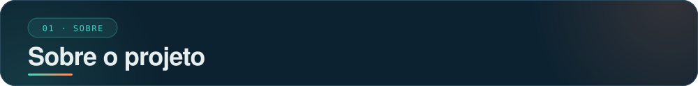

<br />


</div>

Explicações objetivas, questões comentadas, simulados cronometrados e um caderno que lembra o que você errou.

Site de estudos para o **Concurso nº 01/2026 da Câmara Municipal de Itanhaém**
(cargo Agente Administrativo, banca VUNESP, prova em 06/12/2026).
São 40 questões: 8 de Português, 5 de Matemática, 3 de Legislação Municipal e 24 de Conhecimentos Específicos.

<div align="center">

<br />

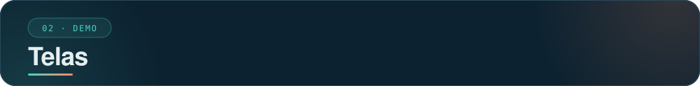

<br />

<picture>
  <source media="(prefers-color-scheme: dark)" srcset="docs/assets/shot-principal-dark.svg" />
  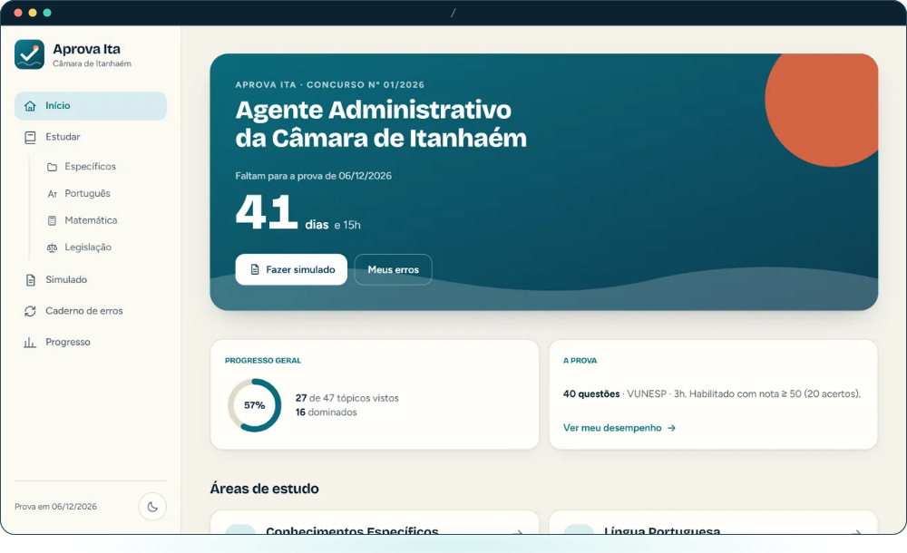
</picture>

<sub>Capturas com progresso fictício, só para demonstração.</sub>

<br />

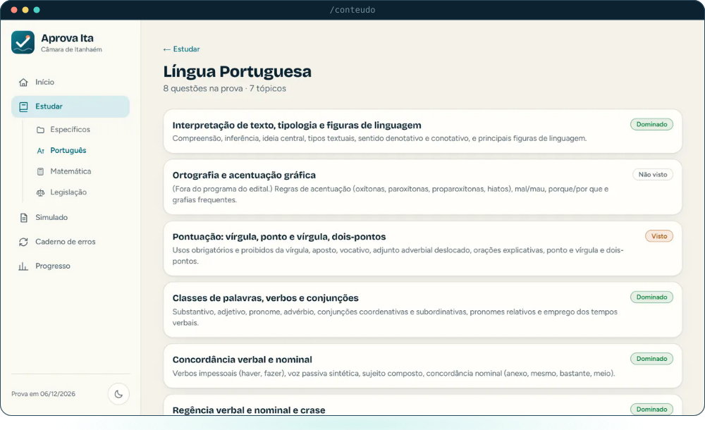

<sub><b>Estudar</b>: os tópicos de cada área, com o seu status.</sub>

<br />

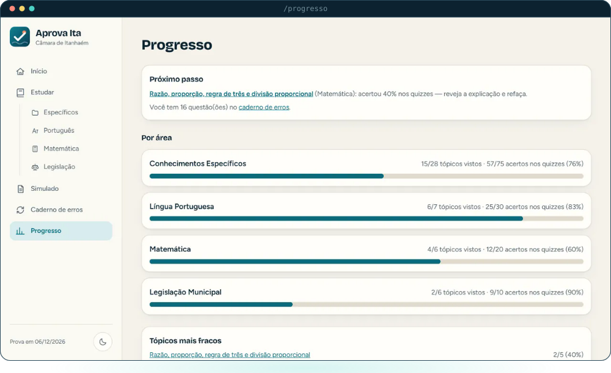

<sub><b>Progresso</b>: desempenho por área e o próximo passo sugerido.</sub>

<br />

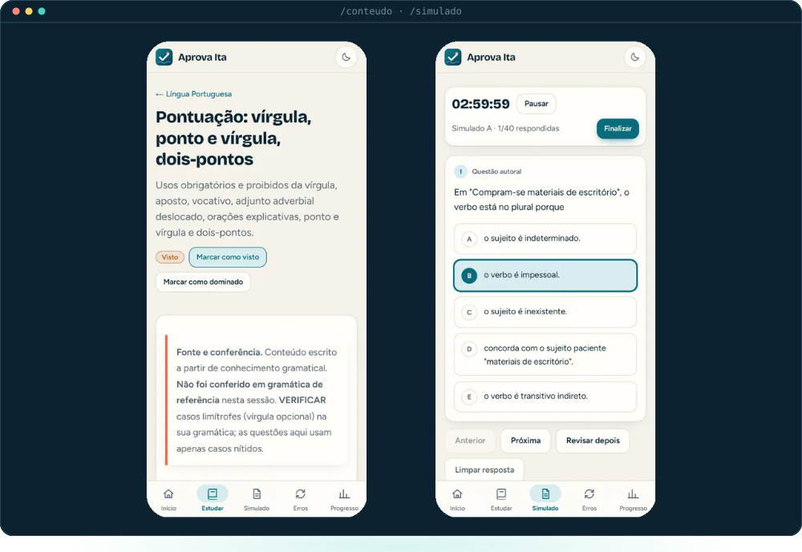

<sub><b>Tópico no celular</b>: explicação objetiva, com a barra de abas embaixo. <b>Simulado</b>: cronômetro, questão e alternativas ao alcance do polegar.</sub>

<br /><br />

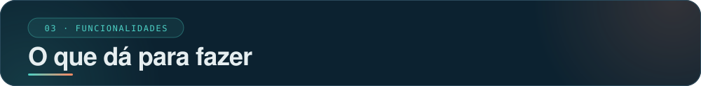

<br />

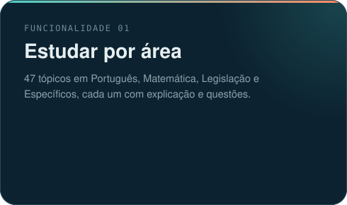
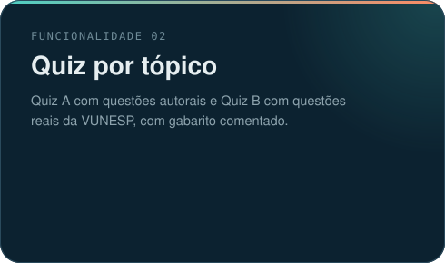
<br />
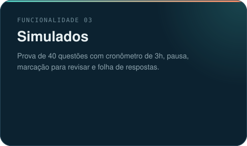
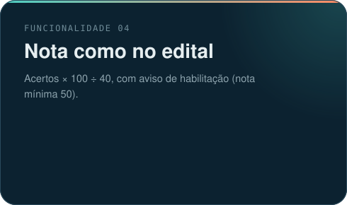
<br />
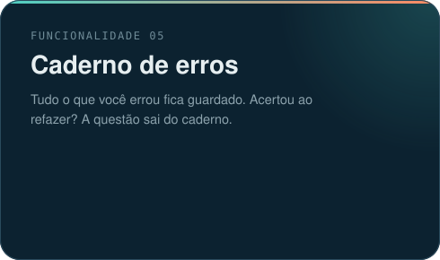
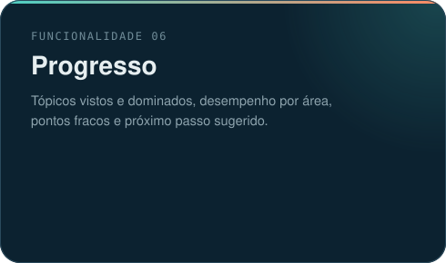
<br />
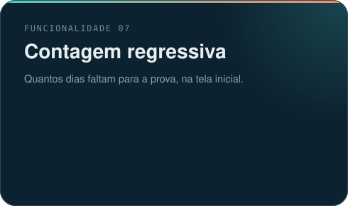
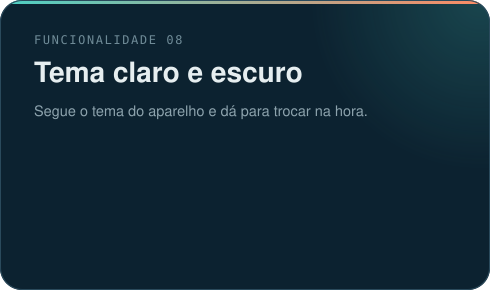

<br /><br />

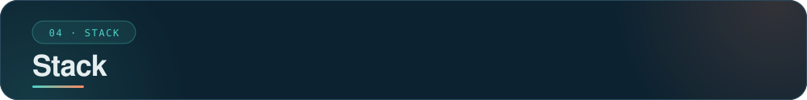

<br />

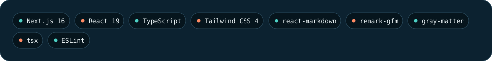

<br /><br />

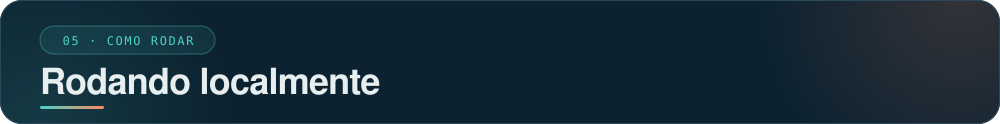

</div>

<br />

Requer [Node.js](https://nodejs.org) e npm.

```bash
git clone https://github.com/diegonatalo/AprovaIta.git
cd AprovaIta
npm install
npm run dev        # http://localhost:3000
```

| Comando | O que faz |
|---|---|
| `npm run dev` | Servidor de desenvolvimento |
| `npm run build` | Gera o site estático em `out/` |
| `npm run lint` | Roda o ESLint |
| `npm run validate` | Confere o conteúdo: fontes, gabaritos e alternativas (`validate:strict` trata avisos como erros) |
| `npm run test:motor` | Testa a correção e a montagem dos simulados |

<div align="center">

<br />

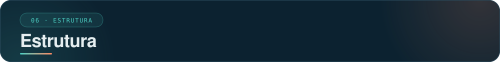

</div>

<br />

```text
src/
├── app/          rotas: início, conteúdo, simulado, revisão e progresso
├── components/   interface: navegação, questões, prova, painéis
└── lib/          carga do conteúdo, correção, simulados e armazenamento local
content/          um tópico por pasta: explicação e questões
config/           parâmetros da prova (prova.ts) e identidade do site (site.ts)
scripts/          validação do conteúdo e testes do motor
public/           ícone, manifest e service worker
docs/             capturas de tela usadas neste README
```

<div align="center">

<br />

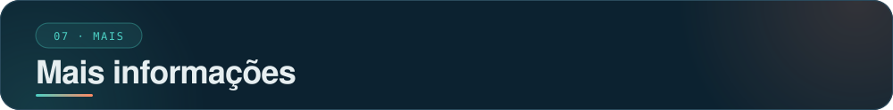

</div>

<br />

### 🔒 Seus dados

Não há conta nem servidor. Seu progresso, os simulados e o caderno de erros ficam no
`localStorage` do navegador. Depois da primeira visita, o site também abre sem internet.

Para trocar de aparelho ou não perder nada ao limpar o navegador, use **Progresso → Backup**:
exporte um arquivo JSON e importe no outro lugar.

### 🧠 Como funciona

| Conceito | Regra |
|---|---|
| **Nota** | `acertos × 100 ÷ 40`. Habilitado com nota igual ou maior que 50 (20 acertos). |
| **Simulado completo** | 40 questões na proporção da prova. Prefere questões que você ainda não fez. |
| **Simulado reduzido** | Se o banco não cobre algum grupo, o simulado sai menor e a nota **não** é comparável ao corte. |
| **Cronômetro** | Calculado pelo relógio, então não perde tempo se a aba ficar em segundo plano. |
| **Prova em andamento** | Fica salva. Você pode recarregar a página e retomar de onde parou. |

### 📚 Sobre o conteúdo

> [!NOTE]
> O conteúdo foi produzido com apoio de IA e **não substitui o edital nem as normas oficiais**.
> Confira os pontos marcados com `VERIFICAR` antes de decorar.

- **Questões da banca** só entram quando vêm de provas reais da VUNESP e têm fonte. Os gabaritos usados
  são os preliminares; mudanças após recursos não foram conferidas.
- **Questões autorais** são identificadas como tal na tela.
- **Legislação municipal:** ainda não há questões reais da banca para esse grupo.
- **Divisão dos 24 Específicos** entre Administração Geral (10), Arquivologia (6) e Administração Pública (8)
  é uma suposição, porque o edital não informa. Ela fica em `config/prova.ts` e pode ser mudada.
- Alguns tópicos estão marcados como "fora do programa do edital" e ficam sinalizados no site.

<details>
<summary><b>Como adicionar um tópico</b></summary>

1. Crie a pasta `content/<area>/<topico>/` (em Específicos, dentro da subárea).
2. Escreva `explicacao.mdx` com `titulo`, `ordem` e `resumo` no cabeçalho.
3. Adicione `questoes-autorais.json` (Quiz A) e, se houver prova real com fonte, `questoes-banca.json` (Quiz B).
4. Rode `npm run validate` e corrija o que ele apontar.

</details>

### 🌐 Deploy

O site é 100% estático (`output: "export"`), então roda em qualquer hospedagem, como a Vercel.
Ao publicar, ajuste o endereço em `config/site.ts`: ele alimenta o `sitemap.xml`, o `robots.txt` e os metadados.

### 🧭 Próximos passos

- [ ] Questões reais da banca para Legislação Municipal (falta prova de Câmara que cubra o tema).
- [ ] Conferir se houve mudança de gabarito após recursos nas provas usadas.
- [ ] Confirmar o horário exato da prova no edital.
- [ ] Definir o endereço público e atualizar `config/site.ts`.
- [ ] Testes automatizados da interface (hoje só há validação do conteúdo e teste do motor).

<div align="center">

<br />

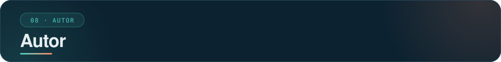

<br />

<a href="https://diegonatalo.dev"></a>
<a href="https://www.linkedin.com/in/diegonatalo/"></a>
<a href="https://github.com/diegonatalo"></a>

<br /><br />


<sub>Feito com 💚 para quem estuda no ônibus, na fila e na hora do almoço.</sub>

</div>
